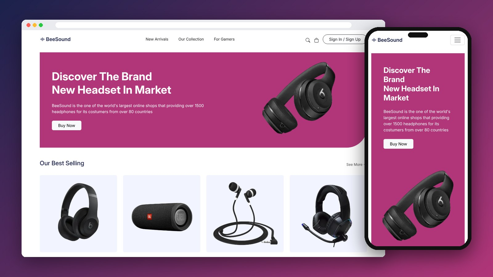

<div align="center">

# BeeSound

An e-commerce store for headphones and speakers, converted from a Figma design using Bootstrap 5.

[](https://mo7-adad.github.io/beesound/)

     

</div>

---



## Features

- 3 pages: Home, Our Collection and Product Details
- Hero banner, best sellers, offers, Black Friday deals and new arrivals
- Product grid with color options and prices
- Product page with image gallery and specs table
- Responsive Bootstrap navbar, grid and cards

## Project Structure

```
beesound/
├── index.html
├── products.html
├── product.html
├── style.css
└── images/
```

## Run Locally

```bash
git clone https://github.com/mo7-adad/beesound.git
cd beesound
```

Then open `index.html` in your browser, or right-click it in VS Code and choose **Open with Live Server**.

## Author

**Mohamed Elhadad** — Front-End Developer

[](https://github.com/mo7-adad)
